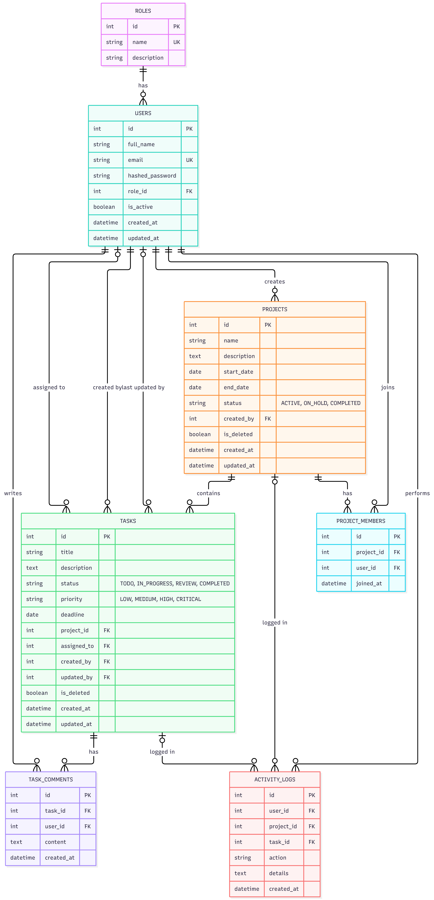
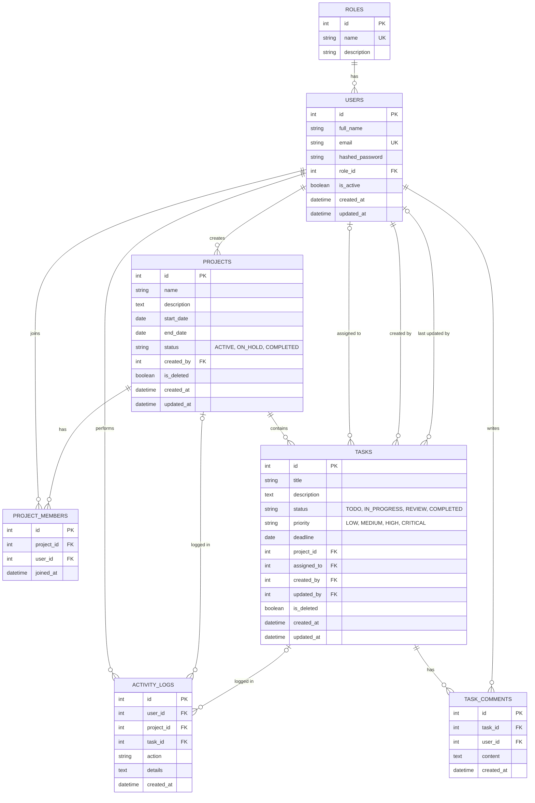

# Database schema (ER diagram)

`project_members` has a unique pair (`project_id`, `user_id`), so nobody can be added to a project twice.
`alembic_version` is a table Alembic creates for itself, so it is not drawn.